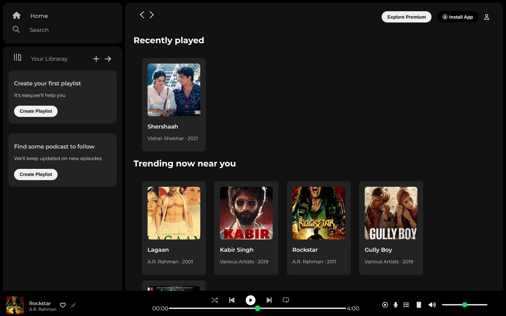
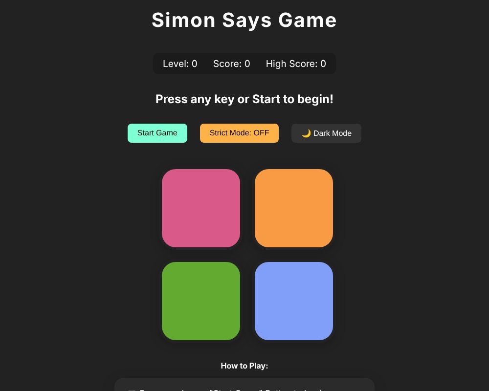
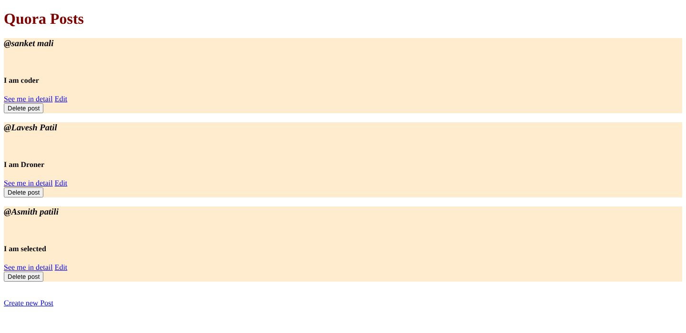
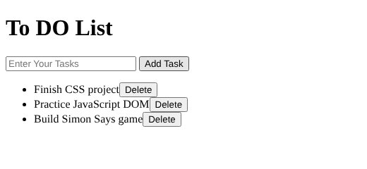

# Web Development Course: Daily Practice

Day-by-day code from a full-stack web development course: HTML and CSS fundamentals through JavaScript, Node.js, Express, EJS templating, REST routes, MongoDB and SQL.


## Project screenshots

> Real captures of the projects in this repository, opened in a browser (Day 34 running with `node app.js`).

**Day 13 – Final CSS project: music-streaming UI clone**

<p align="center"></p>

| Day 24 – Simon Says game | Day 11 – Mini project (landing page) |
|:---:|:---:|
|  |  |
| **Day 34 – RESTful routes with Express + EJS ("Quora posts")** | **Day 24 – To-Do list (DOM)** |
|  |  |

## Structure

Each `DAY N` folder is self-contained.

| Days | Topics (from the code in each folder) |
|---|---|
| 1-5 | HTML tags, CSS basics, logo-design practice |
| 11-13 | Mini project, Bootstrap, final CSS project |
| 16-26 | JavaScript practice and the To-Do mini project |
| 30-34 | Node.js packages, Express, EJS views, RESTful APIs |
| 37 | SQL with Node, generating data with Faker |
| 39-49 | Express + MongoDB, error handling (`ExpressError`), sessions and flash messages |
| `instagram/` | Express + EJS app using a JSON data file |
| `College/` | Form validation and Node.js exercises |

## Run a Node/Express day

```bash
cd "DAY 49"
npm install
node app.js
```

Folders without a `package.json` are static HTML/JS: open the `.html` file in a browser. Some days need a local MongoDB or MySQL instance.

## Note

This is learning material, not production code. Session secrets in the sample apps are placeholders for local practice.

## Author

Sanket Mali · [GitHub](https://github.com/Sanket1516)
